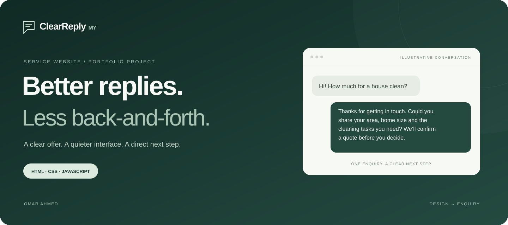
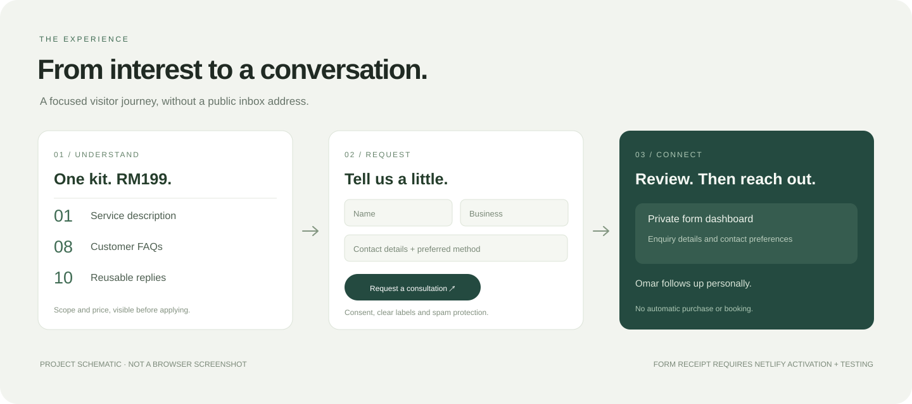

<div align="center">



### A small service. A considered digital experience.

A portfolio project by **Omar Ahmed**: a minimal, responsive website that makes a writing service easy to understand and gives potential clients a clear way to enquire.

**[Explore the live website ↗](https://spiffy-cupcake-a00065.netlify.app)** · [The experience](#the-experience) · [Project highlights](#project-highlights) · [Run locally](#run-locally)

**HTML5** &nbsp; / &nbsp; **CSS3** &nbsp; / &nbsp; **JavaScript** &nbsp; / &nbsp; **Netlify Forms**

</div>

---

## The brief

Create a professional online presence for ClearReply MY, an independent service helping Malaysian residential cleaning businesses explain their services and answer customer enquiries.

The challenge was to make a small offer feel clear and credible without inflated claims, a complicated stack or a public personal email address. The result centres the service, shows an illustrative reply, and invites visitors to request a consultation.

| Audience | Offer | Approach |
| :--- | :--- | :--- |
| Residential cleaning businesses in Malaysia | RM199 Customer Enquiry Kit | A focused page with one primary action |

## The experience



*These custom project graphics explain the brand and visitor journey; they are not browser screenshots or evidence of customer results.*

### 01 — Understand the offer

The headline establishes the problem, an illustrative conversation makes the work tangible, and the package breaks down exactly what is included: **one service description, eight FAQs and ten reusable replies**. Price, exclusions and the revision allowance remain visible.

### 02 — Apply without opening an email app

One consultation form collects the business details needed to start a conversation. Visitors choose email, WhatsApp or a phone call. Selecting either phone-based option makes a phone number required.

### 03 — Keep the next step personal

The form is configured to send enquiries to Netlify's private dashboard so Omar can review them and follow up. No automatic purchase, payment or booking is implied. Actual receipt must be verified after form detection is enabled and the site is deployed.

## Project highlights

| Design & experience | Implementation |
| :--- | :--- |
| **Less, with purpose** — deep green panels, soft cream surfaces and large type | System fonts and self-contained CSS; no external font or UI library |
| **One clear conversion path** — consultation requests throughout the page | Anchor navigation and a standard form POST |
| **Contact privacy** — no owner's personal email in the public page | Contact details are collected through Netlify Forms |
| **Mobile-aware layout** — readable content and stacked sections on small screens | Responsive grids and targeted media queries |
| **Keyboard consideration** — visible focus, explicit labels and a skip link | Native controls and reduced-motion support |
| **Honest submission behaviour** — no simulated successful applications | Local-preview submission guard and dedicated thank-you page |

## Decisions behind the build

**Keep the stack proportional.** A static service page does not need a framework or package installation. Plain HTML, CSS and JavaScript keep this project easy to inspect, edit and deploy.

**Explain before asking.** Visitors see the example, price, scope and process before the form. The consultation is framed as a conversation, not an immediate commitment.

**Make privacy practical.** The public source excludes the owner's email and customer submission data. The form includes contact consent, a privacy explanation and a hidden spam-trap field.

**Show craft without inventing proof.** The example conversation is labelled illustrative. There are no fabricated testimonials, client logos, performance scores or sales guarantees.

## What is verified

- Public website files were checked for the removed owner email and old email links.
- Internal links and label targets were checked.
- Form configuration, required fields and phone-preference behaviour were checked.
- Local-preview submission blocking was checked.

Live form receipt, device-by-device visual testing and accessibility auditing are separate checks; the repository does not claim they have been completed. No conversion or performance measurements are claimed.

<details>
<summary><strong>Project structure</strong></summary>

```text
clearreply-my/
├── public/
│   ├── index.html          # Landing page and consultation form
│   └── thank-you.html      # Form submission destination
├── docs/
│   └── assets/
│       ├── cover.svg      # Project identity graphic
│       └── experience.svg # Visitor journey graphic
├── netlify.toml           # Publishes only public/
└── README.md
```

The portfolio graphics stay outside the deployed website directory.

</details>

## Run locally

Open `public/index.html` in a browser. No installation or build step is required. The form deliberately does not send requests from a local preview.

<details>
<summary><strong>Deployment & form setup</strong></summary>

Keep the existing Netlify project to preserve its URL. Link this repository, use `main` as the production branch, leave the build command empty and publish `public`. The included `netlify.toml` declares the publish directory. Linking the repository in Netlify is a separate setup step; publishing code to GitHub alone does not enable automatic deployments.

Before deploying, enable **Forms → Enable form detection**. After deployment, confirm that `consultation` appears in Forms, send a labelled test using your own details, and check it arrives in the private dashboard. A thank-you page alone does not prove receipt. Optional email notifications are configured privately in Netlify.

For manual deployment, upload the contents of `public`.

[Netlify Forms documentation](https://docs.netlify.com/manage/forms/setup/)

GitHub stores the code. Netlify remains the website host and form handler; GitHub Pages does not provide the Netlify form backend.

</details>

<details>
<summary><strong>Editing & ownership</strong></summary>

Keep personal contact addresses, submission exports, customer information and credentials out of commits. Service descriptions and policies should reflect approved business facts.

© 2026 Omar Ahmed. ClearReply MY is a working service name. No open-source license is granted by this repository.

</details>

---

<div align="center">

**ClearReply MY** · A focused website for a focused service.

[Visit the website ↗](https://spiffy-cupcake-a00065.netlify.app)

</div>
